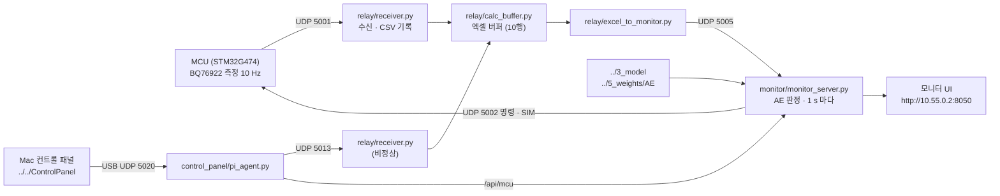

# RaspberryPi — Raspberry Pi 5 실시간 AE 판정

`AI_AutoEncoder(RaspberryPi)`에서 학습한 AE는 **실제로 Raspberry Pi 5에 올라가서 동작합니다.** Pi가 판정에 쓰는 코드와 가중치는 아래 둘입니다.

- 모델 코드: `../3_model`
- 가중치: `../5_weights/AE`

Pi는 측정값을 받아 1 s마다 이 AE로 정상 / 이상을 판정하고 이상 셀을 지목합니다. 모니터 UI에서 결과를 보고, 버튼으로 MCU를 제어합니다.



MCU로 나가는 명령은 모두 모니터의 `mcu_command` 한 곳을 거칩니다. MCU가 요청을 한 번에 하나만 받기 때문입니다.

## 폴더 구성

```
RaspberryPi/
├── monitor/                 AE 판정 서버 + 모니터 UI
│   ├── monitor_server.py    측정 수신 → 1 s 윈도우 → AE 판정 → 웹 UI · API · MCU 명령
│   ├── monitor.html         모니터 화면
│   ├── buffer.html          입력 버퍼 시트 화면 (/buffer)
│   └── run.sh · stop.sh     실행 / 종료
├── relay/                   통신 · 기록 · 엑셀 버퍼
│   ├── receiver.py          UDP 수신, CSV 기록, 엑셀 버퍼로 전달
│   ├── calc_buffer.py       LibreOffice Calc 엑셀 버퍼 (10 행씩 실시간 채움, 10 행마다 저장)
│   └── excel_to_monitor.py  엑셀 버퍼의 10 행 블록 → 모니터 입력 (UDP 5005), 무효 행은 건너뜀
├── control_panel/
│   └── pi_agent.py          컨트롤 패널의 Pi 쪽 대리인: 실측 스냅샷, 프레임을 MCU(SIM)와 AE 로 분배
└── systemd/                 자동 실행 서비스
```

## 설치

저장소를 Pi의 `/home/rpi4/2026ESWContest_mobility_kimdongwooteam`에 둡니다. 서비스 파일이 이 경로를 씁니다.

```bash
# 유선: MCU 가 192.168.50.2 에서 온 패킷만 받습니다
sudo nmcli con mod pcb-eth ipv4.addresses 192.168.50.2/24 && sudo nmcli con up pcb-eth

# 시스템 서비스
sudo cp systemd/pcb-receiver.service /etc/systemd/system/
sudo cp -r systemd/pcb-receiver.service.d /etc/systemd/system/
sudo systemctl daemon-reload && sudo systemctl enable --now pcb-receiver

# 사용자 서비스
cp systemd/pcb-calc-buffer*.service systemd/pcb-excel-to-monitor*.service systemd/pcb-receiver-abnormal.service ~/.config/systemd/user/
systemctl --user daemon-reload
systemctl --user enable --now pcb-calc-buffer pcb-calc-buffer-abnormal pcb-excel-to-monitor pcb-excel-to-monitor-abnormal pcb-receiver-abnormal
```

`pcb-receiver.service.d/mcu-net.conf`가 수신 허용 대역을 `192.168.50.0/24`로 정합니다. Mac과는 USB(`10.55.0.2`)로 연결합니다.

## 실행

```bash
bash monitor/run.sh     # Mac 에서 실행하면 USB 로 Pi 의 모니터를 켜고 브라우저를 엽니다
bash monitor/stop.sh    # Pi 에서 종료
```

화면은 `http://10.55.0.2:8050`입니다. `systemd/aibms-monitor.service`를 쓰면 부팅 때 자동으로 켤 수 있습니다.

**Mac에서 `monitor_server.py`를 직접 실행하지 마세요.** USB 공유로 Mac 패킷이 Pi를 거쳐 MCU까지 가므로, 그 화면의 버튼이 실제 모터를 돌릴 수 있습니다.

## 코드 설명

### monitor — AE 판정 서버

`monitor_server.py`는 UDP 5005로 받은 샘플을 입력 버퍼에 쌓고, 새 샘플 10개(1 s)마다 판정합니다. 1 s 윈도우 요약 → 5 s 간격 12개 이력(55 s) → 라우터(충전 / 주행 / 휴지) → 전문가 AE 순서입니다. 정상 / 비정상 모드에 따라 입력 출처를 걸러서, 비정상 시연 중 들어오는 실측값은 판정에 넣지 않습니다.

| 버튼 | MCU 명령 | 결과 |
|---|---|---|
| 정상주행 시작 | `START` → `MOTOR ON` | 모터 구동, 정상 모드로 판정 시작 |
| 정상주행 정지 | `STOP` | 전체 출력 끔, 센싱 정지 |
| 모터 ON / OFF | `MOTOR ON` / `MOTOR OFF` | 센싱이 꺼져 있으면 함께 켬. OFF 후 센싱 유지 |
| 충전 ON / OFF | `CHARGE ON` / `CHARGE OFF` | 모터와 동시 사용 불가 |

ON은 응답이 없어도 다시 보내지 않고 `STATUS`로 확인하며, 4 s 안에 적용되지 않으면 취소합니다.

| 판정 칸 | 계산 위치 | 기준 |
|---|---|---|
| AI 판정 | Pi | 복원 점수 / τ > 1, 또는 최고 셀 > 4.205 V |
| 기존 임계값 판정 | Pi | COV, CUV, OCD, OT |
| PCB 판정 | **MCU** | 같은 임계값. 폴트면 MCU가 출력 차단 |

| 요청 | 내용 |
|---|---|
| `GET /` · `GET /buffer` | 모니터 화면 · 입력 버퍼 시트 |
| `GET /api/state` | 현재 판정 상태, 이상도, MCU 상태 (JSON) |
| `POST /api/control` | `{"action": "start" \| "stop" \| "reset", "mode": "normal" \| "abnormal"}` |
| `POST /api/motor` | `{"action": "drive_start" \| "drive_stop" \| "motor_on" \| "motor_off" \| "charge_on" \| "charge_off"}` |
| `POST /api/mcu` | Pi 내부 전용 MCU 창구. `STATUS`, `START`, `SIM ...`만 허용 (출력을 켜는 명령은 거부) |

### relay — 통신

| 파일 | 역할 | 포트 |
|---|---|---|
| `receiver.py` | 측정 줄을 `data/bms_YYYYMMDD.csv`에 기록하고 엑셀 버퍼로 넘깁니다 | 정상 5001 → 5011, 비정상 5013 → 5012 |
| `calc_buffer.py` | LibreOffice Calc에 10행씩 실시간으로 채웁니다 | 5011 · 5012 |
| `excel_to_monitor.py` | 10행 블록을 모니터 입력으로 넘깁니다 | → 5005 |

### control_panel — 패널 대리인

`pi_agent.py`는 `ControlPanel/start.sh`가 Pi에서 실행합니다. `10.55.0.2:8061`에서만 열리고, Mac이 UDP 5020으로 보낸 프레임을 AE 경로(5013)와 MCU(`SIM ...,2,...`)로 나눕니다. MCU 응답을 기다리느라 AE 입력이 막히지 않도록 MCU 전송은 별도 스레드에서 합니다.
