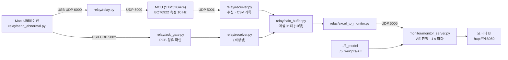

# RaspberryPi — Raspberry Pi 5 실시간 AE 판정

`AI_AutoEncoder`에서 학습한 AE는 **실제로 Raspberry Pi 5에 올라가서 동작합니다.** Pi가 판정에 쓰는 코드와 가중치는 아래 둘입니다.

- 모델 코드: `../3_model`
- 가중치: `../5_weights/AE`

Pi는 MCU(STM32)가 10 Hz로 보내는 셀 전압·온도·전류를 받아, 1 s마다 이 AE로 정상 / 이상을 판정하고 이상 셀을 지목합니다. 결과는 Pi 화면의 모니터 UI에 표시됩니다.

이 폴더에는 그 판정 서버(`monitor/`)와 데이터를 주고받는 통신 코드(`relay/`)가 들어 있습니다.



## 폴더 구성

```
RaspberryPi/
├── monitor/                 AE 판정 서버 + 모니터 UI
│   ├── monitor_server.py    측정 수신 → 1 s 윈도우 → AE 판정 → 웹 UI · API
│   ├── monitor.html         모니터 화면
│   ├── buffer.html          입력 버퍼 시트 화면 (/buffer)
│   └── run.sh · stop.sh     실행 / 종료
├── relay/                   통신 · 기록 · 엑셀 버퍼
│   ├── receiver.py          MCU → Pi 측정 수신 (UDP 5001), CSV 기록, 엑셀 버퍼로 전달
│   ├── ack_gate.py          Mac → Pi (UDP 5002) 시뮬레이션 데이터를 PCB 로 보내 확인(ACK) 후 버퍼로 전달
│   ├── calc_buffer.py       LibreOffice Calc 엑셀 버퍼 (10 행씩 실시간 채움, 10 행마다 저장)
│   ├── excel_to_monitor.py  엑셀 버퍼의 10 행 블록 → 모니터 입력 (UDP 5005)
│   ├── relay.py             Mac(USB, UDP 6000) ↔ PCB(UDP 5000) 명령 중계
│   └── send_abnormal.py     (Mac 에서 실행) 시뮬레이션 CSV → Pi (UDP 5002) 10 Hz 전송
└── systemd/                 부팅 시 자동 실행 서비스 (9 개)
```

## 코드 설명

### monitor — AE 판정 서버

| 파일 | 역할 |
|---|---|
| `monitor_server.py` | **Pi에서 AE를 실행하는 판정 서버.**<br>· UDP 5005로 받은 샘플을 입력 버퍼에 쌓고, 새 샘플 10개(1 s)마다 판정합니다.<br>· 판정 절차: 1 s 윈도우 요약 → 5 s 간격 12개 이력(55 s) → 라우터(충전 / 주행 / 휴지) → 해당 전문가 AE의 셀·팩 점수를 τ와 비교하고, 과충전 규칙을 함께 적용<br>· 모델은 `../3_model`의 `np_model.NpExpert`(numpy만 사용)와 `../5_weights/AE` 가중치를 그대로 불러옵니다. 판정 1회에 약 2 ms 걸립니다.<br>· 기존 BMS 임계값 판정(COV 4.25 V / CUV 2.80 V / OCD 6 A / OT 60 °C)을 함께 계산해 비교 표시합니다.<br>· 받은 원본은 `runtime/rx_log/`, 판정한 윈도우는 `runtime/windows/`에 기록합니다. |
| `monitor.html` | 모니터 화면입니다. 셀별 전압·온도·전류와 변화율 그래프, 수신 센서값, 셀별 AE 이상도, 판정 결과(NORMAL / ABNORMAL, 이상 셀), 기존 임계값 판정을 보여 줍니다. |
| `buffer.html` | 입력 버퍼 시트입니다. 최근 판정 윈도우의 원본 샘플을 표로 보여 줍니다. |
| `run.sh` · `stop.sh` | 모니터 실행 / 종료 |

모니터 API:

| 요청 | 내용 |
|---|---|
| `GET /` · `GET /buffer` | 모니터 화면 · 입력 버퍼 시트 |
| `GET /api/state` | 현재 판정 상태, 이상도, 최근 판정 목록 (JSON) |
| `POST /api/control` | `{"action": "start" \| "stop" \| "reset", "mode": "normal" \| "abnormal"}` |
| `POST /api/ingest` | `{"samples": [...]}` 샘플 직접 입력 |

### relay — 통신

| 파일 | 역할 | 기본 포트 |
|---|---|---|
| `receiver.py` | MCU 측정 CSV 줄을 받아 `data/bms_YYYYMMDD.csv`에 기록하고, 엑셀 버퍼로 넘깁니다. 빠진 seq를 세고, 형식 오류 줄은 따로 남깁니다. | 수신 5001 → 전달 5011 |
| `ack_gate.py` | Mac의 시뮬레이션 데이터를 PCB로 보내고, PCB가 `ACK,<seq>`로 확인한 줄만 버퍼로 넘깁니다. | 수신 5002 → PCB 5002 → 5013 |
| `calc_buffer.py` | LibreOffice Calc 표에 10행씩 실시간으로 채웁니다. 10행마다 `buffer_full(...).xlsx`로 저장합니다. 정상과 비정상을 따로 운용합니다. | 5011 / 5012 |
| `excel_to_monitor.py` | 저장된 10행 블록을 모니터 입력(UDP 5005)으로 넘깁니다. | → 5005 |
| `relay.py` | Mac ↔ PCB 명령 중계입니다. 예: MCU의 출력 차단 명령 `AI:1`. 주고받은 패킷은 `logs/`에 기록합니다. | 6000 → PCB 5000 |
| `send_abnormal.py` | Mac에서 실행합니다. 시뮬레이션 CSV를 Pi로 10 Hz 전송합니다. | → Pi 5002 |

## 설치 · 실행

**1. 저장소를 Pi에 받기**

```bash
cd /home/rpi4
git clone https://github.com/DDongs068/2026ESWContest_mobility_kimdongwooteam.git
sudo apt install python3-numpy libreoffice-calc python3-uno python3-openpyxl
```

**2. 모니터만 실행**

```bash
bash AI_AutoEncoder/RaspberryPi/monitor/run.sh        # → http://<Pi IP>:8050
```

**3. 전체 자동 실행 (systemd)**

```bash
cd AI_AutoEncoder/RaspberryPi/systemd
sudo cp pcb-receiver.service pcb-relay.service /etc/systemd/system/
sudo systemctl enable --now pcb-receiver pcb-relay
mkdir -p ~/.config/systemd/user && cp aibms-monitor.service pcb-ack-gate.service pcb-receiver-abnormal.service \
   pcb-calc-buffer*.service pcb-excel-to-monitor*.service ~/.config/systemd/user/
systemctl --user enable --now aibms-monitor pcb-ack-gate pcb-receiver-abnormal \
   pcb-calc-buffer pcb-calc-buffer-abnormal pcb-excel-to-monitor pcb-excel-to-monitor-abnormal
```

- 서비스 파일의 경로는 저장소를 `/home/rpi4/2026ESWContest_mobility_kimdongwooteam`에 받았다고 가정한 것입니다.

**4. (Mac) 시뮬레이션 데이터 보내기**

```bash
python3 AI_AutoEncoder/RaspberryPi/relay/send_abnormal.py scenario.csv
```

## 네트워크

| 연결 | 주소 |
|---|---|
| Pi ↔ MCU (Ethernet) | Pi 192.168.10.1 · MCU 192.168.10.20 |
| Pi ↔ Mac (USB) | Pi 10.55.0.2 |

샘플 형식은 UDP 한 줄에 샘플 1개, 10 Hz입니다.

```
seq,ms,valid,V1,V2,V3,V4,T1,T2,T3,T4,I,STACK,PACK,LD
```

- 단위: V, °C, A(충전 +, 방전 −), V, V, V
