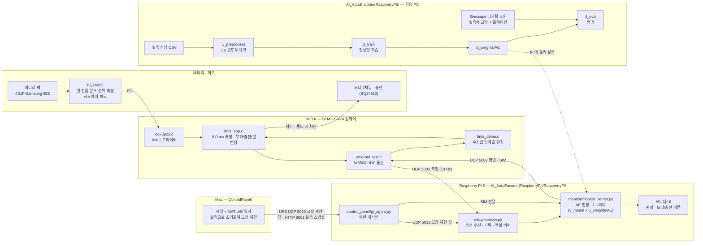

# AI-BMS — 정상 데이터만으로 학습한 AE 기반 배터리 이상 조기 탐지

**2026 임베디드 소프트웨어 경진대회 · 모빌리티 부문 (김동우 팀)**

4S 배터리 팩용 BMS 회로를 직접 설계했습니다. 그 위에서 경량 AutoEncoder(AE)가 임계값 보호로는 잡히지 않는 열폭주 전조를 찾아 알려 줍니다. 대상 전조는 위험 내부단락(soft ISC)과 과충전입니다.

## 전체 구성



## 저장소 구성

```
2026ESWContest_mobility_kimdongwooteam/
├── MCU/                          STM32G474 펌웨어 (STM32CubeIDE 프로젝트)
│   ├── Core/Src/                 main.c · bq76922.c · bms_app.c · bms_demo.c · ethernet_test.c
│   ├── Drivers/                  ST HAL · CMSIS
│   └── aibms_1028_baseline.ioc · Makefile · 링커 스크립트
├── AI_AutoEncoder(RaspberryPi)/               AE 이상 탐지
│   ├── 1_preprocess/             전처리
│   ├── 2_train/                  모델 학습
│   ├── 3_model/                  모델 (PyTorch · Pi 용 numpy 추론)
│   ├── 4_eval/                   평가
│   ├── 5_weights/AE/             모델 가중치
│   ├── RaspberryPi/              Pi 5 실행 코드: AE 판정 서버 · 모니터 UI · 통신 · 패널 대리인 · 서비스
│   └── figures/                  README 그림
├── ControlPanel/                 Mac 컨트롤 패널: MATLAB 고장 재현 → Pi → AE · MCU
└── test.sh                       전체 점검 (통신 · 서비스 · UI · MATLAB · 센싱 · MCU 판정 · 시나리오)
```

| 폴더 | 내용 | 설명서 |
|---|---|---|
| [`MCU/`](MCU) | BQ76922 측정 · 모터/충전/밸런싱 제어 · 수신값 임계값 판정과 출력 차단 · Pi 통신 | [MCU/README.md](MCU/README.md) |
| [`AI_AutoEncoder(RaspberryPi)/`](AI_AutoEncoder(RaspberryPi)) | 1. 전처리 · 2. 모델 학습 · 3. 모델 · 4. 평가 · 5. 모델 가중치 | [AI_AutoEncoder(RaspberryPi)/README.md](AI_AutoEncoder(RaspberryPi)/README.md) |
| [`AI_AutoEncoder(RaspberryPi)/RaspberryPi/`](AI_AutoEncoder(RaspberryPi)/RaspberryPi) | Pi에서 AE를 실행하는 판정 서버 · 모니터 UI · 통신 코드 | [RaspberryPi/README.md](AI_AutoEncoder(RaspberryPi)/RaspberryPi/README.md) |
| [`ControlPanel/`](ControlPanel) | 시연용 고장 재현 패널 (Soft ISC 3종, 과충전) | [ControlPanel/README.md](ControlPanel/README.md) |

---

## 1. 회로 파트

> 회로 설계 설명은 추후 작성 예정입니다.

MCU 펌웨어(STM32G474)의 코드 설명, 빌드 방법, 통신 규약, 안전 동작은 [MCU/README.md](MCU/README.md)에 정리했습니다.

---

## 2. AI 파트 — AE

### 구성

학습은 PC에서 하고, **판정은 Raspberry Pi 5가 합니다.** Pi는 `AI_AutoEncoder(RaspberryPi)`의 모델 코드와 가중치를 그대로 불러와 MCU가 보낸 측정값을 1 s마다 판정하고, 결과를 모니터 UI에 표시합니다. 판정 서버는 `AI_AutoEncoder(RaspberryPi)/RaspberryPi`에 있습니다.

/figures/ae_architecture.png)

1. **입력**
   - 셀 전압 V1~V4, 셀 온도 T1~T4, 팩 전류 I를 10 Hz로 받습니다.
   - 10샘플을 평균해 1 s 윈도우를 만들고, 5 s 간격 12개 윈도우(55 s 흐름)를 이력으로 씁니다.
2. **센싱 라우터**
   - 1 s 평균 전류로 충전 / 주행 / 휴지를 구분합니다.
   - 학습하지 않는 규칙이고, 충전기 연결 같은 별도 신호도 쓰지 않습니다.
3. **전문가 AE**
   - 상태마다 셀 AE와 팩 AE를 하나씩 둡니다.
   - 셀 AE는 4개 셀이 같은 가중치를 공유하므로, 한 셀만 다르게 움직이면 그 셀의 복원오차가 커집니다.
4. **판정**
   - 복원오차를 τ로 나눈 값이 1을 넘으면 이상으로 판정하고, 오차가 가장 큰 셀을 지목합니다.
   - 과충전 사양 규칙(셀 > 4.205 V)을 함께 적용합니다.

### 차별점

| | 기존 BMS 보호 (임계값) | **우리 AE** |
|---|---|---|
| 탐지 대상 | 전압·온도·전류가 한계를 넘은 뒤 | **한계에 닿지 않는 흐름 변화** |
| 학습 데이터 | — | **실측 정상만** · 운전 상태별 전문가 |
| 이상 위치 | 셀 단위 (한계 초과 셀) | **셀 단위 지목** (셀 공용 AE) |
| 실행 환경 | MCU | **Raspberry Pi 5, numpy, 판정 1회 약 0.65 ms, RAM 최대 약 67 MB** |

- **고장 데이터가 필요 없습니다.** 학습, 정규화, 판정 경계를 정상 데이터로 정합니다. 임계값 규칙을 고를 때만 val 시뮬레이션 고장을 참고했습니다.
- **판정 경계는 상태별로 다릅니다.** 충전·주행은 정상 검증 점수 p99.5 × 1.2, 휴지는 최댓값 × 1.2입니다.

### 결과

학습은 실측 정상 36,014 윈도우로 했습니다. 평가의 정상은 학습에 쓰지 않은 실측 test 12,053 윈도우, 이상은 실측에 Simscape 고장을 더한 test 118 파일 12,494 윈도우입니다. 실제 고장 데이터는 아닙니다. 1 s마다 판정했습니다.

| | 정상 판정 | 이상 판정 |
|---|---|---|
| **정상** | TN 11,962 | FP 91 |
| **이상** | FN 219 | TP 12,275 |

| 지표 | 결과 |
|---|---|
| 윈도우 recall / precision | **98.2 %** / 99.3 % |
| 오경보율 (정상 윈도우) | 0.76 % (휴지 72건, 주행 19건, 충전 0건) |
| 파일 탐지 | **118 / 118** |
| 고장 전 경보 | 0 / 11,518 윈도우 |
| 고장 시작 → 첫 경보 (중앙값) | 충전 ISC 13 s · 주행 ISC 32 s · 휴지 ISC 29 s · 과충전 1 s |
| 임계값 보호가 동작하지 않은 Soft ISC | 100 파일 → AE 모두 탐지 |
| 임계값 보호가 동작한 과충전 | 18 파일 → AE가 먼저 경보 6 파일, 대부분 1초 안쪽 차이 |

/figures/ae_detection_example.png)

위 그림은 주행 중 셀2에 2 Ω 내부단락을 더한 예입니다. AE는 고장 후 12초에 경보를 냈고, 이 구간에서 임계값 보호는 동작하지 않았습니다.

**한계**
- 휴지 오경보율이 6.5 %입니다. 휴지 학습 데이터 대부분이 한 세션이라 더 모아야 합니다.
- 임계값 규칙은 val 시뮬레이션 고장을 보고 골랐고, 학습은 1회입니다.

### 모니터 UI (Raspberry Pi 5)

/figures/ui_monitor.png)

- 셀별 전압·온도·전류와 그 변화율을 실시간으로 보여 줍니다.
- 셀별 AE 이상도와 판정 결과(정상 / 이상, 이상 셀), 기존 임계값 판정을 함께 표시합니다.
- MCU가 판정한 PCB 판정과 모터·충전 상태를 표시하고, 버튼으로 정상주행, 모터, 충전을 제어합니다.

### 실행

[`AI_AutoEncoder(RaspberryPi)/README.md`](AI_AutoEncoder(RaspberryPi)/README.md)를 참고하세요.

---

## 3. 시연

Mac의 컨트롤 패널이 시작 순간의 실측값으로 디지털 트윈을 초기화해 고장을 재현하고, Pi를 거쳐 AE와 MCU로 보냅니다. AE는 복원오차로, MCU는 임계값으로 **각자** 판정하므로 AE가 먼저 경보를 내고 뒤이어 MCU가 저전압·과전압으로 출력을 차단하는 흐름을 볼 수 있습니다. 자세한 내용은 [ControlPanel/README.md](ControlPanel/README.md)에 있습니다.

```bash
bash "AI_AutoEncoder(RaspberryPi)/RaspberryPi/monitor/run.sh"   # 모니터 (Mac 에서 실행하면 Pi 에서 켜짐)
zsh ControlPanel/run.sh                          # 컨트롤 패널
bash test.sh                                     # 전체 점검. 모터·충전은 물어보고 y 일 때만 구동
bash test.sh --readonly                          # 상태만 읽음
```
