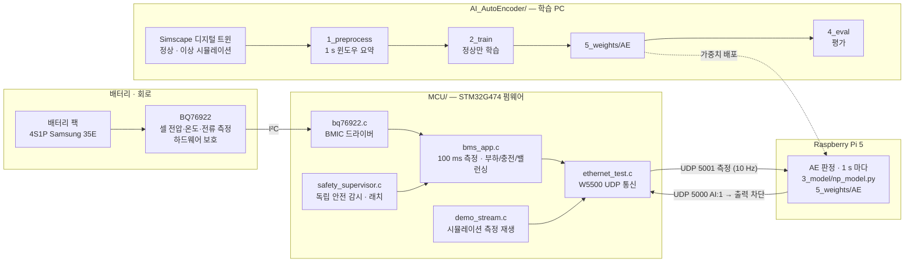
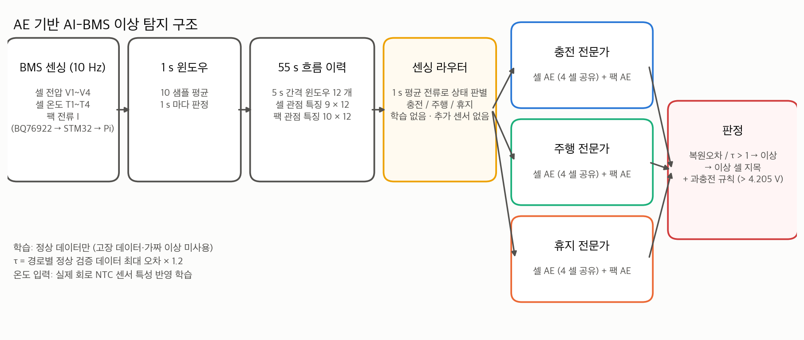
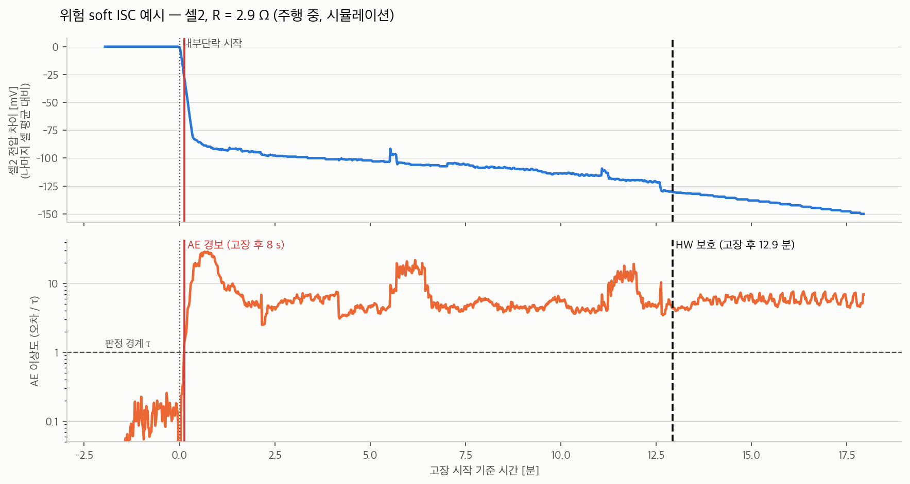
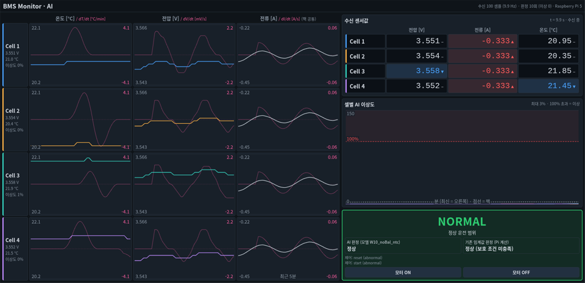

# AI-BMS — 정상 데이터만으로 학습한 AE 기반 배터리 이상 조기 탐지

**2026 임베디드 소프트웨어 경진대회 · 모빌리티 부문 (김동우 팀)**

4S 배터리 팩용 BMS 회로를 직접 설계했습니다. 그 위에서 경량 AutoEncoder(AE)가 열폭주 전조를 하드웨어 보호보다 먼저 찾아 알려 줍니다. 대상 전조는 위험 내부단락(soft ISC)과 과충전입니다.

## 전체 구성



## 저장소 구성

```
2026ESWContest_mobility_kimdongwooteam/
├── MCU/                          STM32G474 펌웨어 (STM32CubeIDE 프로젝트)
│   ├── Core/Src/                 main.c · bq76922.c · bms_app.c · safety_supervisor.c · ethernet_test.c · demo_stream.c
│   ├── Drivers/                  ST HAL · CMSIS
│   └── aibms_final_mcu.ioc · Makefile · 링커 스크립트
├── AI_AutoEncoder/               AE 이상 탐지
│   ├── 1_preprocess/             전처리
│   ├── 2_train/                  모델 학습
│   ├── 3_model/                  모델 (PyTorch · Pi 용 numpy 추론)
│   ├── 4_eval/                   평가
│   └── 5_weights/AE/             모델 가중치
└── docs/                         README 그림 · 그림 생성 코드
```

| 폴더 | 내용 | 설명서 |
|---|---|---|
| [`MCU/`](MCU) | BQ76922 측정 · 안전 감시 · 부하/충전/밸런싱 제어 · Pi 통신 · 측정 재생 | [MCU/README.md](MCU/README.md) |
| [`AI_AutoEncoder/`](AI_AutoEncoder) | 1. 전처리 · 2. 모델 학습 · 3. 모델 · 4. 평가 · 5. 모델 가중치 | [AI_AutoEncoder/README.md](AI_AutoEncoder/README.md) |
| [`docs/`](docs) | 그림 · 그림 생성 코드 | — |

---

## 1. 회로 파트

> 회로 설계 설명은 추후 작성 예정입니다.

MCU 펌웨어(STM32G474)의 코드 설명, 빌드 방법, 통신 규약, 안전 동작은 [MCU/README.md](MCU/README.md)에 정리했습니다.

---

## 2. AI 파트 — AE

### 구성



1. **입력**
   - 셀 전압 V1~V4, 셀 온도 T1~T4, 팩 전류 I를 10 Hz로 받습니다.
   - 10샘플을 평균해 1 s 윈도우를 만들고, 5 s 간격 12개 윈도우(55 s 흐름)를 이력으로 씁니다.
2. **센싱 라우터**
   - 1 s 평균 전류로 충전 / 주행 / 휴지를 구분합니다.
   - 학습하지 않는 규칙이고, 충전기 연결 같은 별도 신호도 쓰지 않습니다.
3. **전문가 AE**
   - 상태마다 셀 AE와 팩 AE를 하나씩 둡니다.
   - 셀 AE는 4개 셀이 같은 가중치를 공유하므로, 한 셀만 다르게 움직이면 그 셀의 복원오차가 커집니다.
4. **판정**
   - 복원오차를 τ로 나눈 값이 1을 넘으면 이상으로 판정하고, 오차가 가장 큰 셀을 지목합니다.
   - 과충전 사양 규칙(셀 > 4.205 V)을 함께 적용합니다.

### 차별점

| | 기존 BMS 보호 (임계값) | 일반 AE | **우리 AE** |
|---|---|---|---|
| 탐지 시점 | 전압·온도가 한계를 넘은 뒤 | — | **한계에 닿기 전 흐름 변화**로 탐지 |
| 학습 데이터 | — | 정상 (운전 상태 섞임) | **정상만** · 운전 상태별 전문가 |
| 운전 변화(주행·충전) 오경보 | 없음 | 많음 | 학습 없는 라우터 + 상태 전환 시 이력 리셋으로 억제 |
| 이상 위치 | 셀 단위 (한계 초과 셀) | 팩 단위 | **셀 단위 지목** (셀 공용 AE) |
| 실제 센서 잡음 | — | 오경보 원인 | 실측 NTC 특성을 학습에 반영해 강건 |
| 실행 환경 | MCU | GPU/PC | **Raspberry Pi 5, numpy, 판정 1회 약 2 ms** |

- **고장 데이터가 필요 없습니다.** 학습, 정규화, 판정 경계를 모두 정상 데이터로만 정합니다.
- **실제 센서에 강건합니다.** 시뮬레이션의 매끈한 온도로만 학습하면 실제 NTC의 0.1 °C 흔들림도 이상으로 판정합니다. 이 경우 오경보율이 84.8 %였습니다. 실측 센서 특성을 학습에 반영해 1.3 %로 낮췄습니다.

### 결과

평가 데이터는 Simscape 디지털 트윈 데이터입니다. 위험 soft ISC(R = 1~25 Ω) 60 run과, 같은 주행·충전 프로파일의 정상 60 run으로 구성됩니다. 온도에는 실측 센서 특성을 반영했고, 1 s마다 판정했습니다.

| 지표 | 결과 |
|---|---|
| ISC 탐지 | **60 / 60 run** |
| 탐지 지연 (고장 시작 → 첫 경보) | 중앙 **2 s** · 최대 191 s |
| 윈도우 recall / precision | 97.0 % / 97.9 % |
| 오경보율 (정상 윈도우) | 1.3 % |
| **하드웨어 보호보다 먼저 경보** | 보호가 동작한 23 run 중 **23 run**, 선행 시간 중앙 **약 5분** |
| 하드웨어 보호가 끝까지 동작하지 않은 ISC | 37 run → AE는 모두 탐지 |



위 그림은 주행 중 셀2에 2.9 Ω 내부단락이 생긴 예입니다. AE는 8초 만에 경보를 냈고, 하드웨어 보호는 12.9분 뒤에 동작했습니다.

### 모니터 UI (Raspberry Pi 5)



- 셀별 전압·온도·전류와 그 변화율을 실시간으로 보여 줍니다.
- 셀별 AE 이상도와 판정 결과(정상 / 이상, 이상 셀), 기존 임계값 판정을 함께 표시합니다.

### 실행

[`AI_AutoEncoder/README.md`](AI_AutoEncoder/README.md)를 참고하세요.
